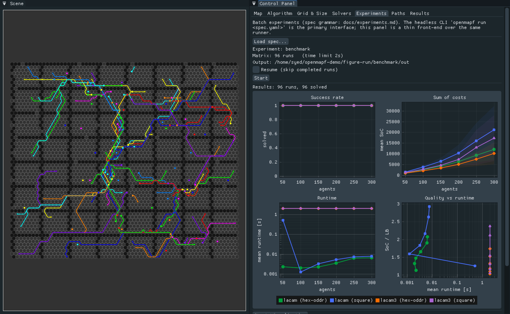

<p align="center">
  
</p>

# OpenMAPF

[](https://github.com/syedjameel/open-mapf-tool/actions/workflows/ci.yml)
[](LICENSE)
<!-- DOI badge added after the first Zenodo deposit (see docs/RELEASING.md) -->

**OpenMAPF makes Multi-Agent Path Finding experimentation easy** — on square
*and* hexagonal grids. It combines three things that usually require stitching
together per-paper scripts:

1. **A batch experiment pipeline**: describe a benchmark matrix
   (solvers × maps × scenarios × agent counts × seeds) in one YAML file, run
   it headless with parallel workers, hard timeouts, and crash-safe resume,
   and get a stable results CSV plus standard MAPF figures.
2. **An interactive GUI** (Dear ImGui + OpenGL): edit maps and obstacles,
   place agent start/goal pairs, load MovingAI benchmark scenarios, run
   solvers, and animate the solutions with pan/zoom and a scrub timeline.
3. **Pluggable external solvers** via a YAML manifest — no recompilation to
   point the tool at a solver binary. Reference integrations: the CBSH2-RTC
   and LaCAM 1/2/3 command lines; hexagonal LaCAM, LaCAM2 and LaCAM3 are
   archived on Zenodo (see below).

All four hexagonal offset layouts (odd-r, even-r, odd-q, even-q)
are supported end to end: editing, scenario generation, solving, and
animation.

## Quick start

### Build from source (Ubuntu)

```sh
sudo apt install cmake build-essential libglfw3-dev libyaml-cpp-dev
git clone --recurse-submodules https://github.com/syedjameel/open-mapf-tool.git
cd open-mapf-tool
cmake -B build && cmake --build build --parallel
```

No system `yaml-cpp`? Configure with `-DOPENMAPF_FETCH_DEPS=ON` to build it
from source automatically. Unit tests: `ctest --test-dir build`.

### Run your first benchmark (no solvers needed)

The bundled smoke experiment exercises the whole pipeline using a fake
solver script and bundled MovingAI sample data:

```sh
build/openmapf run examples/smoke-experiment/experiment.yaml \
    --solvers examples/smoke-experiment/solvers.yaml
scripts/openmapf-plot examples/smoke-experiment/out/results.csv   # needs pandas+matplotlib
```

24 runs execute in seconds; `results.csv`, a provenance `manifest.yaml`, and
three PNG figures land in `examples/smoke-experiment/out/`. See
[docs/experiments.md](docs/experiments.md) for the spec grammar, resume
semantics, and timeout behavior.

### Start the GUI

```sh
build/openmapf
```

Load a map (*Map → Load Map*, e.g. `maps/movingai/random-32-32-10.map`),
load a benchmark scenario for it (*Map → Load Scenario*,
`maps/movingai/random-32-32-10-random-1.scen`, pick the number of agents),
then solve (*Algorithm* tab) or animate previously computed paths
(*Paths* tab, samples in `paths/`). Full walkthrough:
[docs/user-guide.md](docs/user-guide.md).

### Or use Docker

The container image bundles OpenMAPF and the prebuilt hexagonal LaCAM
solvers. One command reproduces the benchmark experiment, figures included:

```sh
docker build -t openmapf .
docker run --rm --user "$(id -u):$(id -g)" -v "$PWD/out:/work" openmapf reproduce
```

Other commands (`smoke`, `run`, `plot`, `test`, `gui`) are described in
[docs/docker.md](docs/docker.md).

### Install real solvers

```sh
scripts/get-solvers.sh          # clones + builds solvers, writes solvers.yaml
```

or point the tool at existing binaries in the GUI *Solvers* tab / in
`solvers.yaml`. The hexagonal LaCAM solvers are archived on Zenodo, with
source code and Linux x86_64 binaries:

- Hexagonal LaCAM: https://doi.org/10.5281/zenodo.23475645
- Hexagonal LaCAM2: https://doi.org/10.5281/zenodo.23475834
- Hexagonal LaCAM3: https://doi.org/10.5281/zenodo.23476002

## Features

- **Batch experiments, headless**: `openmapf run experiment.yaml` — matrix
  expansion, deterministic shuffled run order, bounded parallel workers,
  per-run hard-timeout kill, crash-safe append-only results CSV with
  resume-by-key, per-experiment provenance manifest.
- **Results analysis**: stable, documented CSV schema; `scripts/openmapf-plot`
  renders success-rate, runtime-cactus, and solution-cost figures, or one
  publication figure (`--style paper`, PDF + PNG).
- **Square + four hexagonal grid layouts** (odd-r, even-r, odd-q, even-q).
- **MovingAI-format I/O**: reads/writes `.map` (all terrain codes round-trip)
  and `.scen` v1 — the standard benchmark suites load directly, with
  "first k agents" selection.
- **Interactive editing**: paint/erase obstacles, click to place agent
  start/goal pairs, resize grids (up to 200×200), save map + scenario.
- **Solver execution from the GUI**: CBSH2-RTC-family and LaCAM 1/2/3
  drivers with parameter dialogs, progress/cancel (really kills the child
  process), and per-run statistics (sum of costs and makespan with lower
  bounds, runtime; node expansions for CBS).
- **Animation**: smooth interpolation, speed control (0.1–5×), scrub
  timeline, per-agent colors and path trails, pan (right-drag or
  tap-drag) and wheel zoom.
- **Pluggable solvers** via `solvers.yaml` (GUI editor included); a solver
  with a new output format needs a short parser class, a driver adapter and
  the registration of its key ([docs/extending.md](docs/extending.md)).
- **Quality infrastructure**: 74 headless unit/integration test cases, CI
  matrix with sanitizer and format jobs, `install` target and TGZ/DEB
  packages via CPack.

## Screenshots



Left: a LaCAM3 plan for 104 agents on the MovingAI map room-64-64-8, on the
odd-r hexagonal layout. Right: the Experiments tab with live plots of the
bundled benchmark experiment (96 runs).

## Documentation

| Document | Contents |
|---|---|
| [docs/user-guide.md](docs/user-guide.md) | GUI walkthrough, CLI reference, configuration reference |
| [docs/docker.md](docs/docker.md) | Container image: reproduce experiments, run specs, GUI over X11 |
| [docs/experiments.md](docs/experiments.md) | Batch experiment spec, resume semantics, plotting |
| [docs/file-formats.md](docs/file-formats.md) | Precise grammars: `.map`, `.scen`, path formats, results CSV |
| [docs/extending.md](docs/extending.md) | Adding solvers and output parsers |
| [docs/RELEASING.md](docs/RELEASING.md) | Release + archival procedure (maintainers) |

## Support & contributing

Bugs → [GitHub Issues](https://github.com/syedjameel/open-mapf-tool/issues);
questions → GitHub Discussions. Contributions are welcome — see
[CONTRIBUTING.md](CONTRIBUTING.md) and the
[Code of Conduct](CODE_OF_CONDUCT.md).

## License & citation

MIT — see [LICENSE](LICENSE). Vendored third-party components are listed in
[THIRD_PARTY_NOTICES.md](THIRD_PARTY_NOTICES.md). If you use OpenMAPF in
research, please cite it via [CITATION.cff](CITATION.cff) (a DOI will be
minted with the first archived release).

## Acknowledgements

- [Dear ImGui](https://github.com/ocornut/imgui), [ImPlot](https://github.com/epezent/implot),
  [imgui-filebrowser](https://github.com/AirGuanZ/imgui-filebrowser),
  [GLFW](https://www.glfw.org/), [yaml-cpp](https://github.com/jbeder/yaml-cpp),
  [subprocess.h](https://github.com/sheredom/subprocess.h),
  [Catch2](https://github.com/catchorg/Catch2)
- Benchmark maps/scenarios: [MovingAI](https://movingai.com/benchmarks/)
  (Sturtevant 2012; Stern et al. 2019) — see `maps/movingai/README.md`
- Upstream solvers: [CBSH2-RTC](https://github.com/Jiaoyang-Li/CBSH2-RTC),
  [CBSH2-RTC-CHBP](https://github.com/bshen95/CBSH2-RTC-CHBP),
  [LaCAM](https://github.com/Kei18/lacam) /
  [LaCAM2](https://github.com/Kei18/lacam2) /
  [LaCAM3](https://github.com/Kei18/lacam3) (each retains its own license)
