# MAPF tool

<p align="center">
  
</p>

OpenMAPF is an interactive Multi-Agent Path Finding (MAPF) tool built using ImGui and OpenGL. Unlike typical MAPF visualizers, OpenMAPF supports multiple grid layouts beyond standard square grids, including hexagonal configurations. In addition to visualizing agent paths, the tool aims to provide users to run experiments, evaluate planning algorithms, and generate performance plots for key metrics such as runtime, solution cost, and node expansions.


## 🚀 Features

- Interactive rendering of square and hexagonal grids  
- Load maps and precomputed paths from YAML or plain text files  
- Visually add or remove obstacles on the grid  
- Animate multiple agents with smooth pan and zoom functionality
- Direct integration of CBS
- Built specifically for MAPF research and experimentation
- Interactive support to define agent start and goal positions  
- Additional hexagonal grid types (Even-R, Odd-Q, Even-Q) — currently supports Odd-R  
- Automatic display of runtime statistics (e.g., CT node expansions, solution cost)  

---

## 📦 Prerequisites

Ensure the following dependencies are installed:

- C++17 compatible compiler  
- CMake ≥ 3.10  
- OpenGL  
- GLFW3  
- yaml-cpp  

Install on Ubuntu:

```bash
sudo apt update
sudo apt install libglfw3-dev libyaml-cpp-dev cmake build-essential
```

---

## 🔧 Installation (Ubuntu)

Clone and build the project:

```bash
git clone --recurse-submodules https://github.com/syedjameel/open-mapf-tool.git
cd open-mapf-tool
mkdir build && cd build
cmake ..
make -j$(nproc)
./openmapf
```

---

## 📁 Project Structure

```
.
├── src/                # Source files
├── include/            # Header files
├── vendor/             # ImGui and backends
├── assets/             # Logos and textures
├── CMakeLists.txt
└── README.md
```

---

## 📜 License

This project is licensed under the MIT License. See the [LICENSE](LICENSE) file for full terms.

---


## 🙏 Acknowledgements

- [ImGui](https://github.com/ocornut/imgui)
- [GLFW](https://www.glfw.org/)
- [yaml-cpp](https://github.com/jbeder/yaml-cpp)

- [MovingAi-Benchmark-Maps](https://movingai.com/benchmarks/mapf/index.html)
---

## 📚 External Algorithms / Attribution

This project may incorporate or interoperate with external MAPF algorithms developed by the research community. Credited works include:

- **CBSH2-RTC** – [GitHub](https://github.com/Jiaoyang-Li/CBSH2-RTC)  
- **CBSH2-RTC-CHBP** – [GitHub](https://github.com/bshen95/CBSH2-RTC-CHBP)  
- **LaCAM** – [GitHub](https://github.com/kei18/lacam) (licensed under MIT)

Each linked or embedded algorithm retains its original authorship and license terms.

---

## Batch experiments (headless)

Run a full benchmark matrix — solvers x maps x scenarios x agent counts x
seeds — without a display, resumably and in parallel, then plot the two
standard MAPF figures:

```sh
build/openmapf run examples/smoke-experiment/experiment.yaml \
    --solvers examples/smoke-experiment/solvers.yaml   # works with no real solvers
scripts/openmapf-plot examples/smoke-experiment/out/results.csv
```

See [docs/experiments.md](docs/experiments.md) for the spec grammar, resume
semantics, and the results-CSV schema
([docs/file-formats.md](docs/file-formats.md)).

## 🚧 Planned Features / TODO

- [x] Direct integration with LaCAM
- [x] Experiment module with metrics logging and performance plot generation  

